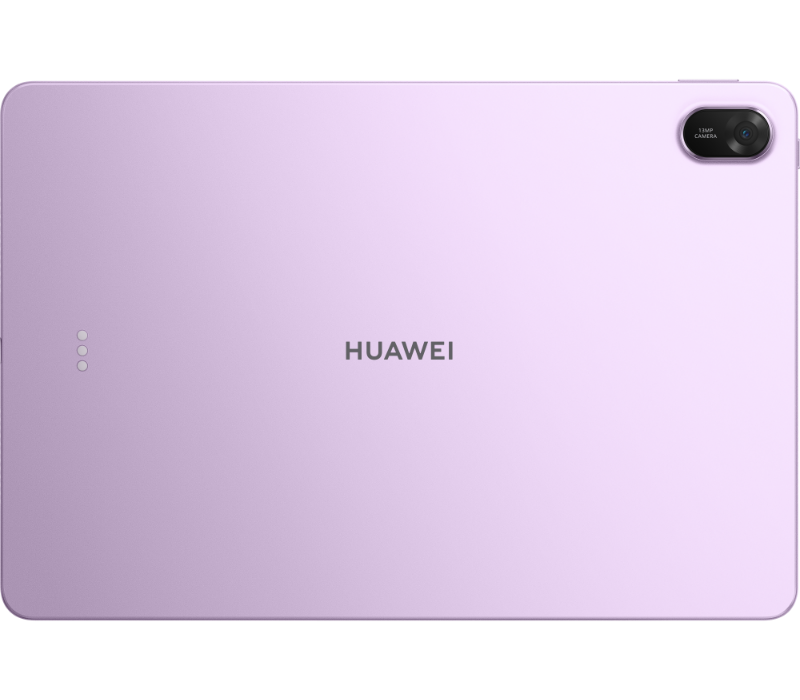
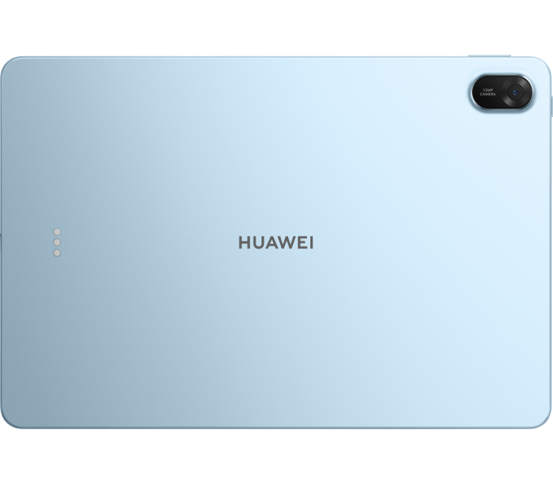
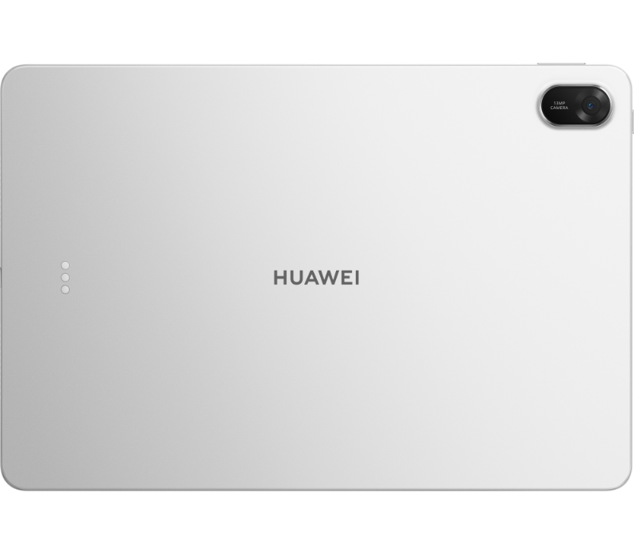

# 周末这块屏，想留给书和电影

小红书 · HUAWEI MatePad 11.5 2026 · 正文 634 字

周末想看点东西：书翻几页，电影挑一部，喜欢的歌再听一遍。要是准备添块平板，HUAWEI MatePad 11.5 2026可以聊聊。📖

11.5英寸IPS触屏。纸书可以摊在桌上，平板里想打开的可能是一篇长文章，也可能是下周出门的路线。尺寸按圆角屏的标准矩形测量，实际可视区域略小。想窝在沙发上看完一部电影的时候，就会惦记一块这样的屏幕。

这块屏幕的分辨率是2456×1600，256ppi，支持最多十点触控。分辨率对应标准矩形，实际有效像素略少。拿起平板，伸手点选，再找个舒服的位置坐下——我对周末的期待差不多就是这样。想看的内容，可以临时改主意。

声音也有自己的位置：四扬声器，HUAWEI Histen 9.0音效。片单里存着的那部电影、最近循环的歌，都让人惦记一块平板的声音配置。看书的时间安静一点，看电影的时候再热闹一点，周末的节目可以自己排。🎵

机身厚6.1毫米，含电池约515克；实际尺寸和重量会因配置、制造工艺、测量方法而有差异。选平板时，我也会想它要放在哪：常用的书桌、床边的小柜子，还是周末出门带的包。拿着用和摆着用，都想过一遍，再聊自己喜欢的尺寸。

系统是HarmonyOS 5.1，机身存储有128GB、256GB，运行内存有8GB、12GB。具体容量随配置而定，系统软件会占用部分空间。想给书、照片和视频各留多少位置，可以按自己的打算选。对我来说，周末添一块屏的吸引力，就在于那些一直想看、还没腾出时间看的东西。

如果这周末有一块平板，你最先想打开哪本书，或哪部电影？

#华为MatePad #MatePad11点5 #平板电脑 #周末日常 #书桌分享

---

具体配置、版本和体验以实际产品及官方信息为准。

[产品信息来源](https://consumer.huawei.com/cn/tablets/matepad-11-5-2026/specs/)

作品编号：`43616e15-6456-4d21-9e05-35303ac70a91` · 版本 3。完整图文与核验依据可在本地工作台“作品记录”按标题查看。

