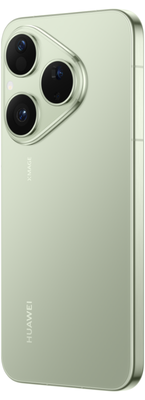

# 树梢那朵花，聊聊Pura 80的长焦

门店朋友圈 · HUAWEI Pura 80 · 正文 261 字

周末逛公园，树梢远处的一朵花正好入眼，想拍这样的画面，可以了解一下HUAWEI Pura 80的长焦配置。

它配备1200万像素潜望式长焦摄像头，采用F3.4光圈，支持OIS光学防抖。拍花时，除了花朵本身，距离也是构图的一部分；这颗长焦对应的焦段为125 mm，适合把远处的一枝花作为取景主角。不同模式的照片和视频像素可能有差异，以实际为准。

后置摄像头支持约5.5倍光学变焦，也支持50倍数字变焦，两者是不同的变焦方式。拍摄功能里还有长焦画中画。对常把镜头朝向树梢、远处花枝的你来说，除了变焦倍率，这项长焦拍摄功能也可以一并了解。

---

[产品信息来源](https://consumer.huawei.com/cn/phones/pura80/specs/)

作品编号：`04ef35fd-2e8c-4576-96af-f254c8db01fe` · 版本 1。完整图文与核验依据可在工作台“作品记录”按标题查看。

